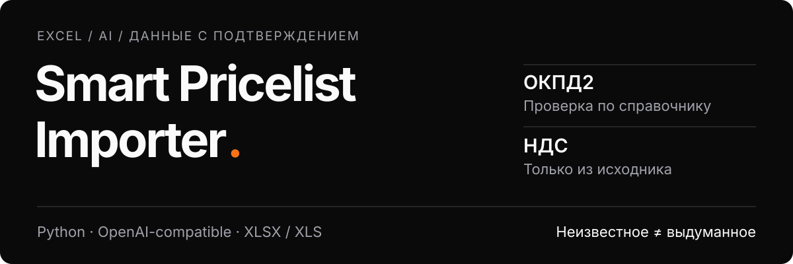

<p align="center">
  
</p>

# Smart Pricelist Importer

Локальный инструмент для разбора Excel-прайсов. Сохраняет исходные строки, использует модель для извлечения характеристик и предложения ОКПД2, проверяет ответ и записывает отдельный JSON-результат.

**Модель предлагает — код проверяет.** Цена и артикул не заменяются ответом модели, несуществующий код ОКПД2 отклоняется, неизвестная ставка НДС остаётся пустой.

## Что происходит с данными

| Исходные сведения | Правило обработки |
| --- | --- |
| Описание товара | Модель предлагает ОКПД2; принимается только точный код из подключённого справочника |
| Явная ставка НДС | Сохраняется как доля: например, `10%` → `0.1` |
| Явная ставка `0%` | Сохраняется `0`, а не пустое значение |
| Ставки НДС нет | Остаётся `null`; категория товара не заменяет налоговые документы |
| «20% жирности» | Не считается ставкой НДС |
| Неизвестный или неподтверждённый признак | Не выдумывается; причина остаётся в отчёте проверки |

Это правила программы, а не пример вымышленного ответа модели. ОКПД2 в результате — **кандидат для проверки человеком**, даже если код существует в справочнике.

## Возможности

- Чтение `.xlsx` и `.xls`: листы, заголовки, исходные значения и координаты строк.
- Сохранение неизвестных колонок и контекста вместо потери информации при нормализации.
- Извлечение характеристик товара через OpenAI-совместимый сервер: тип, бренд, упаковка, масса, объём и другие признаки, если они подтверждаются источником.
- Проверка структуры JSON, полного набора строк и цитат, на которые ссылается модель.
- Ограниченные повторные попытки при временной ошибке или некорректном ответе.
- Отдельный результат без подключения к рабочей базе, записи в ERP или запуска веб-сервиса.

## Быстрый старт

Нужны **Python 3.11+**, доступ к OpenAI-совместимому серверу с подходящей моделью и проверенный справочник ОКПД2.

```bash
git clone https://github.com/vladokan42/smart-pricelist-importer.git
cd smart-pricelist-importer
python3 -m venv .venv
.venv/bin/python -m pip install -r requirements.txt
```

Задай настройки своего сервера. Программа не создаёт аккаунты, не устанавливает модель и не читает настройки AI-агента:

```bash
export LLM_BASE_URL='http://127.0.0.1:8000/v1'
export LLM_MODEL='your-model-id'
export LLM_API_KEY='your-gateway-key'
```

Это **пример настроек**, не адрес поставляемого сервера. `LLM_API_KEY` — ключ выбранного сервера: если используешь шлюз, это ключ шлюза, а не обязательно ключ внешнего провайдера. Условия доступа, квоты и оплата определяются твоим сервером и провайдером.

Запуск на синтетическом примере:

```bash
mkdir -p output
.venv/bin/python examples/create_demo.py output/demo.xlsx
.venv/bin/python import_pricelist.py output/demo.xlsx \
  --supplier 'Демо поставщик' \
  --reference examples/demo_reference.json \
  --out output/result.json
```

Книга содержит четыре вымышленных товара на двух листах: явные ставки `10%` и `0%`, строку без ставки и товар без цены. Это демонстрация различия между пустым значением и нулём, не налоговое утверждение о товарах.

Запуск на своём файле:

```bash
mkdir -p output
.venv/bin/python import_pricelist.py input.xlsx \
  --supplier 'Название поставщика' \
  --reference okpd2.json \
  --out output/result.json
```

Исходная книга не изменяется. Выбери новый путь результата: существующий файл не перезаписывается. Ошибка модели не должна оставлять частичный итог.

## Справочник ОКПД2

`--reference` принимает JSON-словарь с точными кодами и названиями. Подключи свой проверенный **тематический набор** нужной редакции: этот словарь передаётся модели вместе со строками, а предложенный код повторно сверяется с ним. Предел — **64 КиБ UTF-8 JSON включительно**; слишком большой словарь отклоняется до сетевого запроса, не обрезается молча. Программа не загружает справочники автоматически и не исправляет неизвестные коды по префиксу.

Демонстрационный словарь, если используется в примере, — ограниченный тестовый набор. Он не заменяет полный классификатор, не подтверждает ставку НДС и не является нормативной базой.

## Приватность

**При обработке с моделью строки прайса и их контекст отправляются на указанный сервер.** Если за локальным шлюзом стоит внешний провайдер, данные всё равно покидают машину. Для первой проверки используй только синтетические примеры.

В репозитории нет коммерческих прайсов, рабочих баз, токенов или внутренней конфигурации. Файл `.env` не нужно публиковать; настройки задаются через окружение. Подробности — [SECURITY.md](SECURITY.md).

## Проверки

Офлайн-тесты не требуют ключа и не вызывают реальную модель:

```bash
.venv/bin/python -m unittest discover -s tests -v
```

Результаты и границы приёмки — [docs/VALIDATION.md](docs/VALIDATION.md). Успешные тесты с подменённым сетевым ответом не доказывают качество конкретной модели на твоих прайсах.

## Ограничения

- Это самостоятельный CLI, не копия закрытого рабочего сервиса и не универсальный мастер импорта любого Excel.
- Неоднозначные заголовки и цены требуют проверки; автоматический разбор может отказаться принимать файл.
- Формулы не выполняются. В XLSX исходная формула и её кэш различаются; в старом XLS библиотека может вернуть только сохранённый результат, а наличие формулы определить не может.
- Справочник подтверждает существование кода, но не правильность выбора категории.
- НДС не вычисляется по ОКПД2. Неизвестный процент нельзя автоматически использовать для расчёта цены без НДС.
- Рабочий кэш, публикация в базу, поиск по каталогу и инфраструктурные настройки намеренно не включены.

## Происхождение и лицензия

Проект использует выделенные части собственного импортёра Владислава Оканя. Подробнее — [происхождение кода и зависимости](docs/PROVENANCE.md).

[MIT License](LICENSE). Лицензии самостоятельно подключённых моделей и справочников действуют отдельно.
